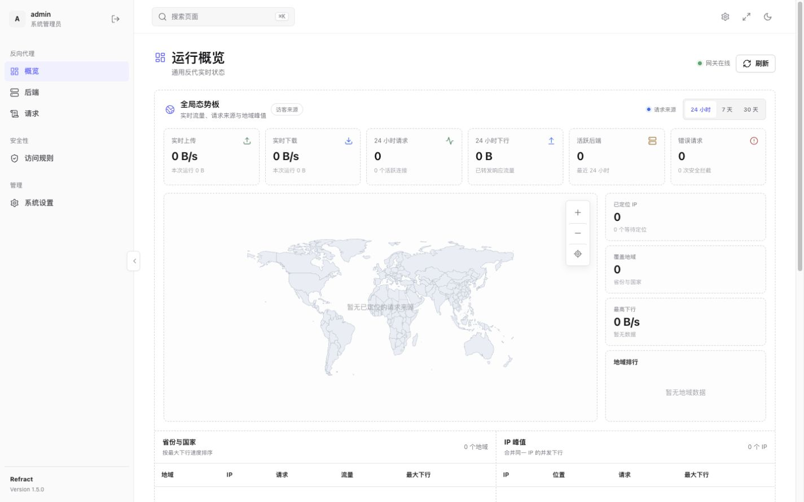

# Refract

[](https://github.com/T-Matrix/Refract/actions/workflows/ci.yml)
[](https://github.com/T-Matrix/Refract/releases)
[](https://github.com/T-Matrix/Refract/releases/tag/v2.0.0-beta.1)
[](LICENSE)
[](go.mod)

Refract 是面向 Emby / Jellyfin 流媒体与通用 HTTP(S) 源站的反向代理与边缘调度网关，单二进制零运行时依赖，提供完整的中文管理控制台。它不仅支持 `proxy.example.com/https://origin.example.com/...` 形态的无预设 URL 折射代理（自动处理 302、HLS、Range、WebSocket 与推流 HMAC 签名），在 **v2.0** 中更演进为支持 **Controller / Edge Agent 分布式集群、AutoTLS 自动证书、智能 DNS 多线调度、可视化流图 WAF、实时观影审计与节点主网卡计费** 的完整反代网关平台。

> [!NOTE]
> **`v2.0.0-beta.1` 为 Beta 尝鲜预发布版本**：GitHub 右侧 Releases 栏默认展示正式版 Latest（`v1.18.0`），预发布版可在 [Releases 页面](https://github.com/T-Matrix/Refract/releases) 查看或下载。v1.x 用户可直接升级，`gateway.db` 与现有配置会在启动时自动平滑迁移，无需重建数据库。



## 部署架构

Refract 支持两种运行模式，共用同一套 Go 二进制与兼容的 SQLite 数据Schema：

| 模式 (`REFRACT_ROLE`) | 适用场景 | 职责说明 |
| --- | --- | --- |
| **`standalone`**（默认） | 单台 VPS 部署 | 同时提供 HTTPS/反代入口、管理控制台 `/panel` 与全套数据持久化 |
| **`controller` + `agent`** | 多台边缘 VPS 集群调度 | **Controller** 专注管理面板、证书签发、DNS 调度与统计审计；**Edge Agent** 承载真实反代流量并毫秒级 SSE 热同步配置，支持断网 Fail-Open 本地续航 |

```text
  播放器 / 客户端 (SenPlayer · Infuse · VidHub · Hills · 浏览器)
         │
         ▼  Cloudflare / AxisNow 智能分流 · Auto-TLS / DNS-01
  ┌──────────────────────────────────────────────────────┐
  │  Edge Agent 边缘节点群 (承载实际媒体流 & DAG WAF 防护)  │
  └──────┬───────────────────────────────────────────▲───┘
         │ 心跳 / 实时流快照 / 网卡字节 / 审计遥测      │ SSE 毫秒级配置 & 证书热推送
         ▼                                           │
  ┌──────────────────────────────────────────────────┴───┐
  │  Controller 集群主控 (管理面板 / DNS 调度 / 观影历史)  │
  └──────────────────────────────────────────────────────┘
```

## 核心能力

### 通用反代与流媒体引擎
- 完整 HTTP/HTTPS 代理，保留原始方法、请求体与查询参数顺序，原生透传 Range / If-Range 与 WebSocket。
- 自动改写 `Location`、`Content-Location`、`Refresh`、Emby JSON 与 HLS `.m3u8` 播放列表地址。
- 自动发现的外部 CDN 推流地址由服务端 HMAC 短期签名并强制执行 DNS/SSRF 安全校验。

### 分布式集群与多反代域名 (`v2.0`)
- 一条发现/接入命令即可将边缘 VPS 接入主控，主控在线下发 `amd64`/`arm64` 二进制实现集群一键批量升级。
- 一机多域托管：按反代域名绑定节点组，支持单域名与单节点粒度覆写默认上游、并发、单 IP 限速及独立 **前置 CDN 真实 IP / 可信 CIDR** 策略。
- Edge Agent 自动维护证书（Let's Encrypt HTTP-01 自动签发、Cloudflare DNS-01 泛域名证书自动续期、手工 PEM 上传或交由外部 CDN 终止）。
- 边缘节点本地持久化最后一份可用配置，主控临时失联时自动 **Fail-Open** 持续服务。

### 智能 DNS 调度与容灾 (`v2.0`)
- **Cloudflare DNS**：支持多节点负载均衡解析与故障主备自动切换。
- **AxisNow 智能分线路 DNS**：支持中国电信 / 联通 / 移动分线路优化解析、健康检查自动摘除与灰云 CNAME 无感联动。

### 可视化流图 WAF 与访问策略 (`v2.0`)
- 拖拽式 DAG 节点编排防火墙规则，支持 **国家/地区 GeoIP、播放器客户端识别、IP/CIDR、URL 路径/查询正则、自定义时段、动作放行/拦截状态码**，并与全局及域名维度绑定。
- 统一播放器黑白名单与设备黑白名单，支持从历史流量中自动识别播放器名称并一键添加规则。
- 支持全局及单域名黑/白名单、每日开放时段（北京时间 `Asia/Shanghai`）与白名单累计下行额度控制。

### 实时观影监控与 Emby 探针 (`v2.0`)
- **正在观看 / 播放历史**：实时识别媒体标题、剧集季集号、多版本片源自动合并、直连播放/直接串流方式、画质规格、播放器、IP 属地与实时下行速率。
- 支持对单条活跃观影流 **一键断开并封禁重连**，立即取消底层连接并阻断同设备回连。
- 内置 **Emby 源站探针**：周期探测源站可用率（24h/7d/30d）、延迟趋势，支持公开探针页展示与隐私主机名脱敏。

### 节点主网卡月度流量计费 (`v2.0`)
- 自动解析 Linux `/proc/net/route`、`ipv6_route` 与 sysfs（`lower_*` 穿透 VLAN/桥接）识别物理主网卡，智能排除 `lo`、Docker 网桥、`veth`、WireGuard/TUN 等虚拟接口流量。
- 支持按 **双向（RX+TX）/ 出站 / 入站** 统计 VPS 月度配额、80%/100% Telegram 告警、达限自动排空下线以及提高配额或跨计费周期自动恢复上线。

## 一键部署与升级

### 1. 准备条件
- Linux VPS（`amd64` 或 `arm64`），使用 `root` 或 `sudo` 权限运行。
- 已解析到 VPS 的公网域名，防火墙放行 TCP 80 / TCP 443（使用 HTTP/3 时放行 UDP 443）。
- 支持 Debian、Ubuntu、RHEL、CentOS、Fedora 与 Alpine，脚本会自动安装 Docker Engine 与 Compose 插件（如缺失）。

### 2. 全新安装

**单机模式（默认）**：

```bash
curl -fsSL https://raw.githubusercontent.com/T-Matrix/Refract/main/scripts/install.sh -o install-refract.sh
less install-refract.sh
sudo sh install-refract.sh
```

非交互指定默认上游或允许域名列表：

```bash
curl -fsSL https://raw.githubusercontent.com/T-Matrix/Refract/main/scripts/install.sh \
  | sudo sh -s -- \
      --domain proxy.example.com \
      --upstream https://emby.example.com \
      --yes
```

**集群主控模式 (`controller`)**：主控只承载管理面板，边缘节点部署完成后可在后台「节点管理」一键复制对应边缘机型的安装接入命令：

```bash
curl -fsSL https://raw.githubusercontent.com/T-Matrix/Refract/main/scripts/install.sh \
  | sudo sh -s -- \
      --role controller \
      --domain ctrl.example.com \
      --yes
```

**通用公网反代模式**（允许代理任意未签名公网目标）：

```bash
curl -fsSL https://raw.githubusercontent.com/T-Matrix/Refract/main/scripts/install.sh \
  | sudo sh -s -- \
      --domain proxy.example.com \
      --public-proxy \
      --yes
```

> [!WARNING]
> `--public-proxy` 允许任何访客通过你的网关代理任意公网目标，请配合 WAF 规则、黑白名单与单 IP 并发限速使用。

部署完成后访问 `https://你的域名/setup` 初始化管理员账号。

### 3. 从 v1.x 一键升级到 v2.0

所有 v1.x 的 `.env`、SQLite 数据（`gateway.db`）、规则、管理员账号和证书都会自动保留并完成结构迁移：

- **Docker Compose 部署**（拉取 `main` 最新源码并原地重建容器，含 `v2.0` 新特性）：

```bash
curl -fsSL https://raw.githubusercontent.com/T-Matrix/Refract/main/scripts/install.sh | sudo sh
```

如部署在自定义目录（例如 `/data/refract`）：

```bash
curl -fsSL https://raw.githubusercontent.com/T-Matrix/Refract/main/scripts/install.sh | sudo sh -s -- --install-dir /你的安装目录
```

- **原生 systemd 部署（`/opt/vps-url-gateway`）**：
  - 升级到最新正式版（`Latest`）：直接执行 `sudo sh` 即可自动校验 SHA-256、替换并健康检查，失败自动回滚。
  - **尝鲜升级到 `v2.0.0-beta.1`**：通过 `--version` 指定预发布标签：

```bash
curl -fsSL https://raw.githubusercontent.com/T-Matrix/Refract/main/scripts/install.sh | sudo sh -s -- --version v2.0.0-beta.1
```

早期原生部署若缺少维护 Socket，可单独补装通道而不修改任何业务配置：

```bash
curl -fsSL https://raw.githubusercontent.com/T-Matrix/Refract/main/scripts/install.sh | sudo sh -s -- --repair-panel-update
```

## 手动部署

需要 Docker Engine 与 Docker Compose v2：

```bash
git clone https://github.com/T-Matrix/Refract.git
cd Refract
cp .env.example .env
openssl rand -hex 32
```

在 `.env` 中配置 `PROXY_DOMAIN`、`SIGNING_SECRET`（≥32 字符）、`ADMIN_ENABLED=true`、`ADMIN_SESSION_SECRET`（≥32 字符）及可选的 `REFRACT_ROLE`、`DEFAULT_UPSTREAM`，然后启动：

```bash
docker compose up -d --build
docker compose ps
curl https://你的域名/_gateway/health
```

## 管理面板功能概览

| 模块 | 主要能力 |
| --- | --- |
| 运行概览 | 实时吞吐、周期流量趋势、可缩放世界/中国省份请求地图、客户端峰值、Emby 与节点状态 |
| 正在观看 / 历史 | 实时并发会话、多版本片源合并、画质与播放方式识别、一键踢线阻断与观影记录检索 |
| 集群节点 (`v2.0`) | 主控/Edge 节点管理、一键接入命令、在线升级二进制、Linux 主网卡月流量配额与排空控制 |
| 反代域名 (`v2.0`) | 多域绑定、节点分配、AutoTLS / DNS-01 证书状态、单域策略与前置 CDN IP 覆写 |
| 智能 DNS (`v2.0`) | Cloudflare 多节点解析 / 故障切换组、AxisNow 三网智能解析方案与灰云 CNAME 联动 |
| 防火墙 WAF (`v2.0`) | 可视化 DAG 流程规则编排（GeoIP / 播放器 / IP / 路径 / 开放时段）、触发 trace 与统计 |
| 访问规则 / 统计 | 域名黑白名单、白名单流量额度、播放器与设备策略、24h~90d 统计报表与 CSV 导出 |
| Emby 探针 / 通知 | 源站心跳可用率与延迟统计、Telegram 告警与日报、Turnstile 人机验证、审计日志与备份恢复 |

## 主要配置变量

| 变量 | 默认值 | 说明 |
| --- | --- | --- |
| `REFRACT_ROLE` | `standalone` | 运行角色：`standalone`（单机）、`controller`（集群主控）或 `agent`（边缘节点） |
| `PROXY_DOMAIN` | 必填 | 已解析到入口节点的公网域名 |
| `DEFAULT_UPSTREAM` | 空 | 默认 Emby/Jellyfin 地址；设置后可直接用 `https://代理域名` 访问 |
| `ALLOWED_UPSTREAMS` | 空 | 域名策略关闭时允许代理的目标主机，支持通配符 `*.example.com` |
| `SIGNING_SECRET` | 必填 | 至少 32 字符，用于自动发现推流链接签名 |
| `ALLOW_UNSIGNED_TARGETS` | `false` | 是否允许通用开放反代任意公网 URL |
| `ALLOW_PRIVATE_TARGETS` | `false` | 是否允许访问私网/回环/保留地址（默认禁止防 SSRF） |
| `TRUST_PROXY_HEADERS` | `false` | 是否允许采信转发头（**仅对匹配 `TRUSTED_PROXY_CIDRS` 的上游生效**） |
| `TRUSTED_PROXY_CIDRS` | 空 | 可信前置代理/CDN CIDR 列表，如 Cloudflare/OpenFlare 节点段 |
| `PASS_CLIENT_IP` | `false` | 是否向上游转发解析后的客户端真实 IP |
| `UPSTREAM_IP_MODE` | `auto` | 连接上游时的 IP 解析策略：`auto`、`ipv4`、`ipv6` |
| `ADMIN_ENABLED` | `false` | 是否启用中文管理控制台（`controller` 默认开启，`agent` 强制关闭） |
| `ADMIN_SESSION_SECRET` | 必填 | 至少 32 字符的管理会话与敏感凭据加密主密钥 |
| `GEOIP_LOOKUP_URL` | `ipwho.is` | 须为包含 `{ip}` 占位符的 HTTPS GeoIP 查询接口 |
| `MAX_CONCURRENT_REQUESTS` | `256` | 全局最大并发请求数 |
| `MAX_CONCURRENT_PER_IP` | `64` | 单客户端 IP 最大并发数 |
| `MAX_DOWNLOAD_MBIT_PER_IP` | `0` | 单客户端 IP 所有连接聚合下行上限（Mbps，`0` 不限） |

完整变量说明参见 [.env.example](.env.example)。面板内保存的可调配置位于 `runtime-config.json`，支持校验失败自动回滚；敏感密钥永不回传前端。

## 接入现有反向代理

使用外部 Nginx/Caddy 放在 Refract（HTTP `:8080`）前置时，务必保留原始斜杠与 WebSocket 升级头，并在前置层剥离不可信客户端伪造的 CDN IP 头：

```nginx
map $http_upgrade $connection_upgrade {
    default upgrade;
    ''      close;
}

server {
    merge_slashes off;

    location / {
        proxy_pass http://127.0.0.1:8080;
        proxy_http_version 1.1;
        proxy_set_header Host $http_host;
        proxy_set_header X-Forwarded-Proto $scheme;
        proxy_set_header X-Forwarded-Host $http_host;
        proxy_set_header X-Real-IP $remote_addr;
        proxy_set_header CF-Connecting-IP "";
        proxy_set_header True-Client-IP "";
        proxy_set_header EO-Connecting-IP "";
        proxy_set_header CF-IPCountry "";
        proxy_set_header Upgrade $http_upgrade;
        proxy_set_header Connection $connection_upgrade;
        proxy_buffering off;
        proxy_request_buffering off;
    }
}
```

## 安全模型

- 所有代理目标在 DNS 解析前后均固定校验并阻断私网、回环、链路本地及 IPv6 过渡保留地址（SSRF 防护）。
- 前置代理头（`X-Real-IP`、`X-Forwarded-For`、`CF-Connecting-IP`、`CF-IPCountry` 等）严格校验证明来自 `TRUSTED_PROXY_CIDRS` 可信对端后才生效。
- 管理员会话使用 `HttpOnly`、`Secure`、`SameSite=Strict` Cookie，写操作校验同源并内置防爆破 IP 封禁；SQLite 内敏感 API Token / 私钥使用派生 AES-256-GCM 密文存储。
- Edge Agent 与 Controller 间通过独立节点密钥鉴权，Controller 公共探针/节点接口不暴露私有边缘节点清单元数据。

漏洞报告方式参见 [SECURITY.md](SECURITY.md)。

## 开发与测试

```bash
go vet ./...
go test -race ./...
sh -n scripts/install.sh scripts/release-notes.sh
docker build -t refract:dev .
```

GitHub Actions 会在提交时执行全量测试，并在推送 `v*` 标签后交叉编译 Linux `amd64` / `arm64` 产物、生成 `SHA256SUMS.txt` 与 Release（带 `-` 的预发布标签会自动标记为 Pre-release）。

贡献规范参见 [CONTRIBUTING.md](CONTRIBUTING.md)，更新日志参见 [CHANGELOG.md](CHANGELOG.md)。

## 许可证与致谢

Refract 源码采用 [MIT License](LICENSE) 开源。内置的 Lucide、Apache ECharts、地图数据及其他第三方声明见 [THIRD_PARTY_NOTICES.md](THIRD_PARTY_NOTICES.md) 与 [Apache License 2.0](LICENSE-APACHE-2.0)。
